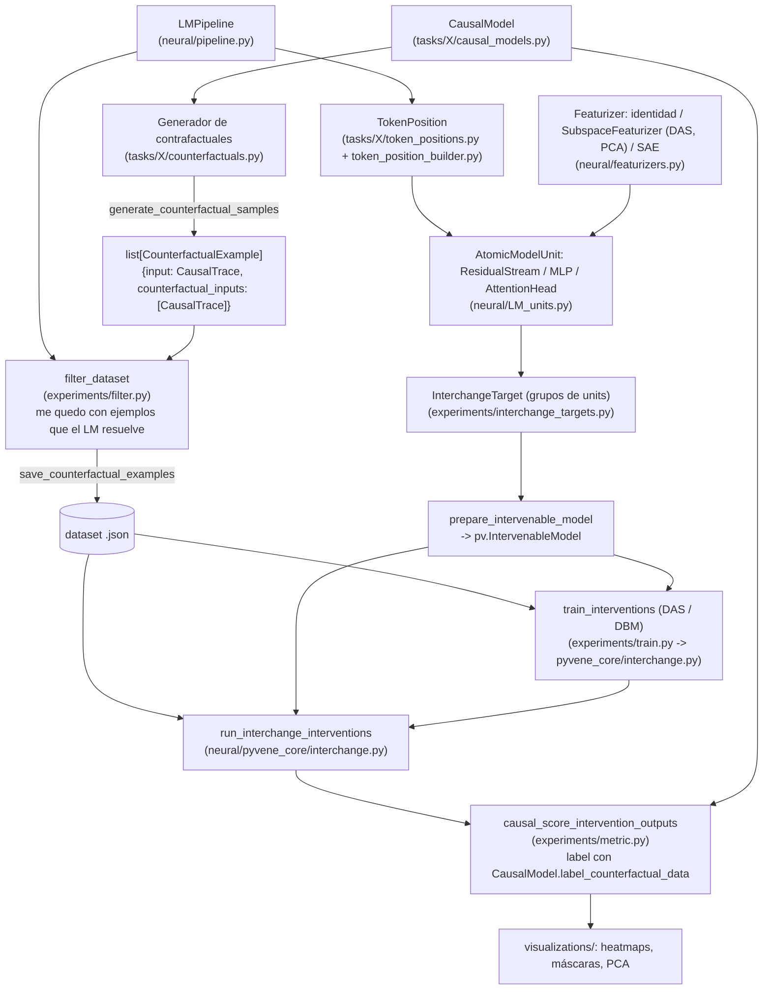

# causalab: visión general del código

`causalab` es la librería de goodfire-ai para hacer **interpretabilidad mecanicista con causal abstraction**. La pregunta que intenta responder es: dado un algoritmo de alto nivel que yo creo que el modelo de lenguaje implementa (por ejemplo "primero busco qué posición tiene el color correcto, después leo la letra de esa posición"), ¿en qué parte de la red (capa, token, cabeza de atención, subespacio) vive cada variable de ese algoritmo, y qué tan fiel es la correspondencia?

Estos apuntes recorren el código del paquete (`causalab/causalab/`), no las notebooks. Este archivo da el mapa general; los siguientes bajan a cada submódulo:

- `01_causal.md`: `causalab/causalab/causal/` (modelos causales, trazas, datasets contrafactuales).
- `02_neural.md`: `causalab/causalab/neural/` (pipeline del LM, model units, featurizers, token positions, integración con pyvene).
- `03_experiments.md`: `causalab/causalab/experiments/` (entrenamiento DAS/DBM, métricas, jobs, visualizaciones).
- `04_tasks.md`: `causalab/causalab/tasks/` (MCQA, IOI, entity_binding, general_addition).

## Ideas clave / teoría

### Causal abstraction

El README (`causalab/README.md`) lo plantea así: un algoritmo es un **modelo causal**, una red neuronal también es un modelo causal, y "la red implementa el algoritmo" significa que hay una relación de **causal abstraction** entre los dos. El algoritmo es el **modelo de alto nivel**; la red es el **modelo de bajo nivel**. Si los mecanismos de alto nivel son simplificaciones fieles de los de bajo nivel, el alto nivel es una abstracción causal del bajo nivel.

Un modelo causal (en `causal/causal_model.py`) tiene:

- **variables** (conceptos que podrían estar representados en la red),
- **values** (valores posibles de cada variable),
- relaciones **padre-hijo** (un DAG),
- **mechanisms** (funciones que calculan el valor de una variable a partir de sus padres).

Siempre hay dos variables especiales: `raw_input` (el prompt en texto) y `raw_output` (la respuesta esperada en texto). Son el "puente" entre el modelo de alto nivel y el LM: el LM recibe `raw_input` y debería producir `raw_output`.

### Interchange intervention

Es el experimento básico para testear si una variable de alto nivel X está alineada con una parte H de la red:

1. Tomo un input **base** y un input **contrafactual** (counterfactual / source).
2. En el modelo de alto nivel: corro el base, pero fijo X al valor que X toma en el contrafactual. Eso me da una salida esperada (el **label**).
3. En la red: corro el base, pero reemplazo la activación H por la activación H que produjo el contrafactual. Miro la salida del LM.
4. Si la salida del LM coincide con el label en la mayoría de los ejemplos, H "se comporta como" X. La proporción de aciertos se llama **interchange intervention accuracy** (en el código es simplemente el `avg_score`).

### Features y featurizers

La librería no se casa con una unidad básica (neuronas, direcciones, features de SAE). Toda activación se mira a través de un **featurizer invertible**: una función `x -> (f, error)` y su inversa `(f, error) -> x`. Puede ser la identidad, una rotación ortogonal (DAS, PCA) o un autoencoder (SAE). La intervención se hace en el espacio de features `f` y después se vuelve al espacio original. Esto está en `neural/featurizers.py`.

### Los métodos de "construcción de features" que soporta

Según el README, cinco líneas base:

1. **Full vector**: patchear el vector oculto completo (featurizer identidad, sin seleccionar features).
2. **DAS (Distributed Alignment Search)**: aprender una rotación ortogonal (un subespacio de dimensión k) supervisada por el modelo causal. En código: `SubspaceFeaturizer` + intervención `"interchange"` entrenada.
3. **DBM (Desiderata-Based Masking)**: aprender una máscara binaria (relajada con sigmoide y temperatura) sobre features o sobre unidades completas. En código: intervención `"mask"`.
4. **PCA**: direcciones no supervisadas (componentes principales); se puede combinar con DBM para elegir componentes.
5. **SAE**: features de autoencoders preentrenados (GemmaScope, LlamaScope); también combinables con DBM. En el código existe `SAEFeaturizer`, marcado como "currently unused".

Además hay un sexto método en `experiments/jobs/`: **Boundless DAS** (rotación entrenable + máscara por feature, entrenadas juntas).

## Arquitectura del paquete

Ojo: la sección "Repository Structure" del README está desactualizada (menciona `experiments/pyvene_core.py`, `intervention_experiment.py`, etc., que ya no existen). La estructura real es:

```
causalab/causalab/
├── causal/
│   ├── trace.py                 # Mechanism, input_var, CausalTrace (estado de una ejecución)
│   ├── causal_model.py          # CausalModel (DAG + interchange + labeling)
│   ├── counterfactual_dataset.py# TypedDicts CounterfactualExample / LabeledCounterfactualExample
│   ├── causal_utils.py          # generar/guardar/cargar datasets, scoring post-hoc, caminos vivos
│   └── causal_viz.py            # dibujar el DAG (networkx/matplotlib y Dash/Cytoscape)
├── neural/
│   ├── pipeline.py              # Pipeline (ABC) y LMPipeline (HF causal LM)
│   ├── model_units.py           # ComponentIndexer, AtomicModelUnit, InterchangeTarget
│   ├── LM_units.py              # ResidualStream, MLP, AttentionHead
│   ├── featurizers.py           # Featurizer, SubspaceFeaturizer, SAEFeaturizer + clases de intervención pyvene
│   ├── token_position_builder.py# TokenPosition, Template, specs declarativos de posiciones
│   └── pyvene_core/
│       ├── intervenable_model.py# construir / borrar pv.IntervenableModel
│       ├── interchange.py       # preparar inputs, correr interchange en lotes, loop de entrenamiento
│       └── collect.py           # recolectar activaciones, SVD/PCA, cross-model patching
├── experiments/
│   ├── train.py                 # train_interventions (DAS/DBM de punta a punta: entrenar + evaluar + guardar)
│   ├── metric.py                # scoring y la loss de entrenamiento
│   ├── filter.py                # filtrar ejemplos donde el LM ya acierta
│   ├── interchange_targets.py   # builders de grillas de InterchangeTarget (capas x posiciones / cabezas)
│   ├── io.py                    # guardar JSON / safetensors / modelos
│   ├── configs/train_config.py  # DEFAULT_CONFIG y merge
│   ├── jobs/                    # experimentos "llave en mano" (tracing, grids de score, DAS, DBM, PCA...)
│   └── visualizations/          # heatmaps, máscaras, scatter PCA, análisis en texto
└── tasks/
    ├── MCQA/                    # tarea activa y mantenida
    ├── IOI/, entity_binding/, general_addition/   # marcadas DEPRECATED
```

El reparto de responsabilidades es bastante limpio:

- `causal/` no sabe nada de redes neuronales: es puro Python (más `torch`/`numpy` en `causal_utils.py` para scores).
- `neural/` sabe de transformers y pyvene pero no de tareas concretas.
- `experiments/` combina las dos cosas: corre intervenciones en la red y las compara con lo que dice el modelo causal.
- `tasks/` son "plugins": cada tarea define su modelo causal, sus generadores de contrafactuales y sus token positions.

## Flujo de un experimento típico, de punta a punta



En palabras, paso por paso:

1. **Definir el modelo causal.** Armo un dict `{variable: Mechanism(parents, compute)}` y un dict de `values`, y construyo `CausalModel(mechanisms, values)`. El constructor deriva padres, hijos, inputs, outputs y "timesteps" (orden topológico). Ejemplo real: `tasks/MCQA/causal_models.py` define `positional_causal_model`.
2. **Generar el dataset contrafactual.** Un sampler devuelve `{"input": trace_base, "counterfactual_inputs": [trace_cf]}`. `causal_utils.generate_counterfactual_samples(size, sampler, filter)` lo repite hasta tener `size` ejemplos. Cada trace es un `CausalTrace` con todas las variables ya calculadas (incluido `raw_input`).
3. **Cargar el LM.** `LMPipeline("gpt2", max_new_tokens=1, max_length=...)` carga tokenizer y modelo de HuggingFace, fuerza atención "eager", desactiva `use_cache` en la config, y define `pad_token = eos_token` con padding a la izquierda.
4. **Filtrar.** `filter_dataset(dataset, pipeline, causal_model, metric)` corre el LM sin intervenciones sobre bases y contrafactuales y se queda solo con los ejemplos donde la salida del LM coincide con `raw_output`. No tiene sentido medir si una intervención "cambia la respuesta como predice el modelo causal" si el LM ni siquiera resuelve la tarea.
5. **Elegir dónde intervenir.** Defino **token positions** (`TokenPosition`, normalmente con el sistema declarativo de `token_position_builder.py`: "último token", "el token de la variable `symbol0`", "el token siguiente a X"...). Con eso armo **model units**: `ResidualStream(layer, token_position)`, `MLP(...)`, `AttentionHead(layer, head, token_position)`. Las agrupo en un `InterchangeTarget` (lista de grupos; cada grupo comparte un input contrafactual). Los builders de `experiments/interchange_targets.py` arman grillas completas (todas las capas x todas las posiciones).
6. **Elegir el featurizer.** Por defecto cada unit usa `Featurizer()` (identidad = full vector). Para DAS se pone un `SubspaceFeaturizer` entrenable; para PCA un `SubspaceFeaturizer` con la rotación de `compute_svd`, congelado.
7. **Intervenir con pyvene.** `prepare_intervenable_model` traduce cada unit a un dict de config de pyvene (`component`, `unit`, `layer`, `group_key`, `intervention_type`) y construye un `pv.IntervenableModel`. `run_interchange_interventions` arma en cada batch las posiciones a intervenir de base y contrafactual (`{"sources->base": (cf_indices, base_indices)}`), y llama a `intervenable_model.generate(...)` vía `LMPipeline.intervenable_generate`.
8. **Entrenar (opcional).** Para DAS/DBM, `experiments/train.py:train_interventions` etiqueta el dataset con el modelo causal (`label_counterfactual_data`), entrena los parámetros de las intervenciones (rotación o máscara) con cross-entropy sobre los tokens del label, y después evalúa en train y test con `run_interchange_interventions`.
9. **Medir.** `experiments/metric.py:causal_score_intervention_outputs` recalcula el label con el modelo causal para cada grupo de variables objetivo, compara contra la salida del LM intervenido con un `metric(output_dict, expected) -> bool` que pasa el usuario, y promedia.
10. **Visualizar.** `experiments/visualizations/` dibuja heatmaps capa x posición (o capa x cabeza), máscaras binarias de DBM, conteos de features seleccionadas y scatter plots de PCA.

Los **jobs** de `experiments/jobs/` empaquetan los pasos 5 a 10 para casos frecuentes:

| Job | Archivo | Qué hace |
|---|---|---|
| Tracing del residual stream | `jobs/residual_stream_tracing.py` | patchea un par de prompts en cada (capa, token) y dibuja qué token sale |
| Grid de interchange scores | `jobs/interchange_score_grid.py` | full-vector patching en una grilla de targets, scoring contra el modelo causal, heatmap |
| DAS en grilla | `jobs/DAS_grid.py` | entrena un DAS por target y dibuja heatmaps train/test |
| DBM binario | `jobs/DBM_binary_grid.py` | una máscara escalar por unit: selecciona unidades completas |
| DBM por feature | `jobs/DBM_feature_masks_grid.py` | máscara por dimensión del featurizer (p.ej. sobre PCA) |
| Boundless DAS | `jobs/boundless_DAS_feature_mask_grid.py` | rotación entrenable + máscara por feature |
| PCA | `jobs/collect_PCA.py` | recolecta activaciones, PCA, scatter plots |

## Conceptos transversales que conviene tener claros

- **Grupos y `group_key`.** Un `InterchangeTarget` es `list[list[AtomicModelUnit]]`. El índice del grupo exterior es el índice del contrafactual: el grupo 0 toma sus activaciones de `counterfactual_inputs[0]`, el grupo 1 de `counterfactual_inputs[1]`, etc. Por eso `prepare_intervenable_model` pasa `group_key=i` a pyvene.
- **`is_original`.** Las token positions pueden devolver posiciones distintas para la base y para el contrafactual (`paired_token_position`). En `prepare_intervenable_inputs` se llama `index_component(..., is_original=True)` para la base y `is_original=False` para los contrafactuales.
- **`feature_indices`.** Subconjunto de coordenadas del featurizer que se intercambian. `None` significa "todas". Después de entrenar DBM, una unit no seleccionada queda con `[]` (ninguna).
- **Cross-model patching.** Casi todas las funciones aceptan `source_pipeline`: si se pasa, las activaciones del contrafactual se recolectan en *otro* modelo y se inyectan en el target vía `source_representations` de pyvene.
- **`CLAUDE.md`** del repo no describe el código: son convenciones de trabajo ("cuestioná el enfoque, no solo la implementación", "entendé las causas raíz", "simplificá"...). No hay info técnica ahí.

## Ojo / errores comunes / dudas

- El README habla de archivos (`experiments/pyvene_core.py`, `LM_experiments/`, `benchmark_experiment.py`) que no existen. La fuente de verdad es el árbol de arriba.
- Solo `tasks/MCQA` usa la API actual de `CausalModel(mechanisms, values, ...)`. IOI, entity_binding y general_addition llaman `CausalModel(variables, values, parents, mechanisms, id=...)`, que es la firma vieja; con la firma actual eso no funciona (ver `04_tasks.md`).
- Casi todos los ejemplos y tests construyen `LMPipeline(..., max_length=N)`. Eso hace que todos los prompts se paddeen a la misma longitud, lo cual importa para que las token positions calculadas ejemplo por ejemplo coincidan con las del batch (ver `02_neural.md`).
- Los docstrings de varios jobs muestran imports como `causalab.experiments.scripts...`; ese módulo no existe, el real es `causalab.experiments.jobs...`.

## Resumen de una línea por sección

- **Causal abstraction**: el algoritmo es un modelo causal de alto nivel; buscamos dónde vive cada variable en la red con interchange interventions.
- **Featurizers**: toda intervención pasa por un mapa invertible `x -> (f, error)`; identidad, rotación (DAS/PCA) o SAE.
- **Arquitectura**: `causal/` (algoritmo), `neural/` (red + pyvene), `experiments/` (unir ambos, entrenar y medir), `tasks/` (tareas concretas).
- **Flujo**: CausalModel → dataset contrafactual → filtrar con el LM → token positions → model units → InterchangeTarget → featurizer → pyvene → (entrenar DAS/DBM) → score contra labels causales → heatmaps.
- **Jobs**: tracing, grid de scores, DAS, DBM binario, DBM por feature, Boundless DAS, PCA.
